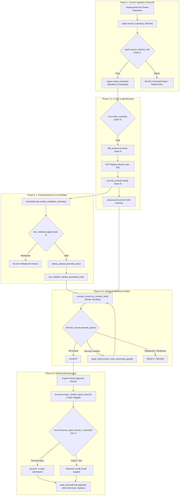

# SATRA-RV Architecture & Verification Flow

## 1. System Component Flowchart



---

## 2. Recommit Sequence Diagram

This sequence diagram depicts the exact function calls, policy gates, and verification points in the recommit workflow. Notice: **no force-push (`-f`) is used**, commits are **trailer-tagged** (not cryptographic GPG signatures), and every action is appended to the hash-chained audit trail.

```mermaid
sequenceDiagram
    autonumber
    actor Operator as Human Reviewer
    participant API as backend.satra.api
    participant Recommit as backend.satra.recommit
    participant Ingest as backend.satra.ingest
    participant Git as Target Git Worktree
    participant Forge as Remote Forge (Threat-Repository)
    participant Audit as backend.satra.audit_trail

    Operator->>API: POST /api/satra/repair/approve (run_id, branch, user)
    Note over API: Verifies run_id and 7-gate matrix passed

    API->>Recommit: create_verified_repair_branch(repo, base_sha, run_id)
    Recommit->>Recommit: get_unique_repair_branch_name(repo, base_sha, run_id)
    Note over Recommit: Ensures no overwrite; creates satra/repair/<sha7> or satra/repair/<sha7>-<run8>

    Recommit->>Git: git checkout -B branch_name base_sha
    Recommit->>Recommit: prepare_trailer_tagged_commit_message(msg, run_id, approver)
    Note over Recommit: Adds ASENT-Verified-By, Run-ID, Approved-By, Approved-At
    Recommit->>Git: git commit -m commit_msg --author="ASENT Security Gate"

    API->>Recommit: push_repair_branch_if_allowed(repo, branch_name, settings, approval_record)
    
    rect rgb(240, 248, 255)
        Note over Recommit: Policy Verification Gates:<br/>1. PYTEST_CURRENT_TEST is unset<br/>2. SATRA_ALLOW_PUSH == 1<br/>3. approval_record.approved == True<br/>4. origin URL matches allowlist
    end

    alt Policy Gates Pass
        Recommit->>Forge: git push -u origin branch_name (NORMAL PUSH - NO -f!)
        Forge-->>Recommit: Push succeeded (new branch ref created)
        Recommit-->>API: {pushed: true, branch: branch_name}
    else Policy Gate Disabled or In Test
        Recommit-->>API: {pushed: false, reason: "Push disabled by policy / test env"}
    end

    API->>Audit: AuditTrail.append(run_id, operator, action, branch, commit_sha)
    Note over Audit: Computes SHA-256 hash over canonical entry + prev_hash
    Audit-->>API: Appended to append-only satra_audit.jsonl
    API-->>Operator: 200 OK (status, branch, commit_sha, audit_entry)
```
