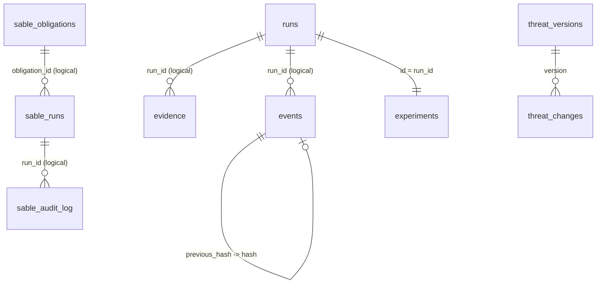
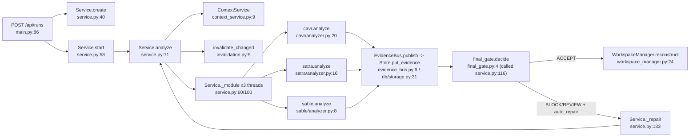

# ASENT architecture facts (source of truth for the report diagrams)

Generated 2026-10-14 by static reading of the code with `git show <ref>:<path>`. Nothing was checked out or run.
Every `file:line` below is on **master** unless a branch is named.

| Ref | Commit | Relation to master |
|---|---|---|
| `master` | `107d08f` | — |
| `origin/cavr` | `4a432cb` | ancestor of master (0 ahead, 126 behind) |
| `origin/satra-feature` | `36671ee` | ancestor of master (0 ahead, 72 behind) |
| `origin/sable` (Ali's branch, see note) | `ffe8aa9` | ancestor of master (0 ahead, 52 behind) |

- **Ali's branch:** the request left this as `origin/<Ali's branch>`. I used `origin/sable` because it holds Muhammad Ali Sajjad's commits on the SABLE module. Ali also authored `origin/integration/sable-satra-cavr` (`fab6a76`), which is 1 commit ahead of master and only changes `report/chapters/*.tex`. It has no backend difference.
- All three branches are fully merged into master, so master is a superset of them. Sections 1–4 describe master. Section 5 lists every backend difference on the branches.

**Method:** Python `ast` over every `backend/**/*.py`. A "function" or "class" means a **top-level** `def`/`async def`/`class` in a module. Methods, nested functions and the route closures inside `threat_repo/api.py:15 router()` are not counted. `backend/satra/seed_rules.py` starts with a UTF-8 BOM and was decoded as `utf-8-sig`.

---

## 1. Functions vs classes per package

### 1.1 Totals per package (all four refs)

| Package | master f / c | origin/cavr f / c | origin/satra-feature f / c | origin/sable f / c |
|---|---|---|---|---|
| `backend/` root (`main.py`, `cli.py`, `config.py`) | 23 / 5 | 23 / 5 | 23 / 5 | 23 / 5 |
| `backend/cavr` (incl. `fixtures/`, `sample_project/`) | 217 / 19 | 217 / 19 | 217 / 19 | 217 / 19 |
| ↳ of which `cavr/fixtures` | 1 / 0 | 1 / 0 | 1 / 0 | 1 / 0 |
| ↳ of which `cavr/sample_project/**` | 1 / 2 | 1 / 2 | 1 / 2 | 1 / 2 |
| `backend/db` | 0 / 1 | 0 / 1 | 0 / 1 | 0 / 1 |
| `backend/integrations` | 14 / 4 | 14 / 4 | 14 / 4 | 14 / 4 |
| `backend/orchestrator` | 14 / 6 | 14 / 6 | 14 / 6 | 14 / 6 |
| `backend/sable` (incl. `fixtures/`) | 59 / 5 | 58 / 5 | 58 / 5 | 59 / 5 |
| ↳ of which `sable/fixtures` | 3 / 0 | 3 / 0 | 3 / 0 | 3 / 0 |
| `backend/satra` (incl. `trusted/trusted_tests/`) | 150 / 10 | 36 / 3 | 149 / 10 | 149 / 10 |
| ↳ of which `satra/trusted/trusted_tests` (pytest functions) | 24 / 0 | — (absent) | 24 / 0 | 24 / 0 |
| `backend/threat_repo` | 20 / 6 | 20 / 6 | 20 / 6 | 20 / 6 |
| **Total** | **497 / 56** | **382 / 49** | **495 / 56** | **496 / 56** |
| Python files under `backend/` | 131 | 114 | 131 | 131 |

Where the counts differ (all checked with `git diff <branch> master`):
- `sable` 58 → 59: master adds `unresolved_role_binding` (`backend/sable/policy_semantics.py:16`). `origin/sable` already has it.
- `satra` 149 → 150: master adds `select_tests_for_regions` (`backend/satra/contract_runner.py:151`).
- `satra` on `origin/cavr` has only 16 files. These are absent there: `astscan`, `audit_trail`, `cli`, `contract_runner`, `decision_engine`, `ingest`, `live_pipeline`, `ollama_adapter`, `recommit`, `repair_inline`, `settings`, `trust` and `trusted/`.

Per-file counts for master are in Appendix A.

### 1.2 Class classification (master, all 56)

**Protocols (1)**

| Class | Where | Note |
|---|---|---|
| `AgentAdapter(Protocol)` | `backend/integrations/agent_adapter.py:9` | Declares `events()`. Nothing is annotated with it. `ReplayAdapter` (`:18`) has `events()`. `WorkspaceWatchAdapter` (`:12`) has only `poll()`, so it does not match the Protocol structurally. |

The PyPI transports share a duck-typed `stream(url)` interface but no Protocol declares it: `HttpxTransport` `cavr/pypi_client.py:61`, `TamperingTransport` `cavr/api.py:131`, `OfflineTransport` `cavr/api.py:146`.

**Data models (22)**

| Kind | Class | Where |
|---|---|---|
| Pydantic API body | `Intake`, `Revision`, `Command`, `Event`, `ReplayInput` | `backend/main.py:42`, `:51`, `:52`, `:53`, `:55` |
| Pydantic domain | `RunContext` | `backend/orchestrator/run_context.py:9` |
| Pydantic domain | `Evidence` | `backend/orchestrator/run_context.py:37` |
| Pydantic API body | `InterceptRequest`, `AlternativeApprovalRequest` | `backend/cavr/api.py:115`, `:122` |
| Pydantic API body | `RunRequest`, `AuditRequest` | `backend/sable/api.py:49`, `:56` |
| Pydantic API body | `FetchRequest`, `RunRequest`, `ApproveRecommitRequest` | `backend/satra/api.py:32`, `:38`, `:47` |
| Pydantic API body | `Toggle`, `OSVInput`, `OSVQuery` | `backend/threat_repo/api.py:8`, `:9`, `:10` |
| Pydantic domain | `ThreatRecord`, `ThreatImport` | `backend/threat_repo/models.py:6`, `:19` |
| `NamedTuple` | `PolicyStatement`, `AuthResult` | `backend/sable/authorization.py:22`, `:29` |
| `@dataclass(frozen=True)` | `SatraSettings` | `backend/satra/settings.py:50` |

**Services (22).** These are stateful classes that own I/O, storage or an external process.

| Role | Class | Where | Used by (backend, master) |
|---|---|---|---|
| Orchestrator | `Service` | `backend/orchestrator/service.py:31` | `main.py:18` (one instance) |
| Orchestrator | `ContextService` | `backend/orchestrator/context_service.py:9` | `service.py:56,80,159,225,238` |
| Orchestrator | `EvidenceBus` | `backend/orchestrator/evidence_bus.py:3` | `service.py:54,75` |
| Orchestrator | `WorkspaceManager` | `backend/orchestrator/workspace_manager.py:7` | `service.py:33` |
| Persistence | `Store` | `backend/db/storage.py:8` | `service.py:33` |
| Persistence | `CavrStorage` | `backend/cavr/storage.py:128` | `cavr/api.py:60`, `cavr/pip_shim.py:215` |
| Persistence | `SableStorage` | `backend/sable/storage.py:13` | `sable/api.py` (module-level `storage`) |
| Persistence | `ThreatRepository` | `backend/threat_repo/repository.py:24` | `service.py:35` |
| Persistence | `AuditTrail` | `backend/satra/audit_trail.py:19` | **no caller in backend** |
| Adapter | `OSV` | `backend/integrations/osv_adapter.py:10` | `cavr/analyzer.py:64` |
| Adapter | `WorkspaceWatchAdapter` | `backend/integrations/agent_adapter.py:12` | `service.py:207` |
| Adapter | `ReplayAdapter` | `backend/integrations/agent_adapter.py:18` | `integrations/replay.py` |
| Adapter | `HttpxTransport` | `backend/cavr/pypi_client.py:61` | `pypi_client`, `cavr/api.py:353` |
| Adapter | `TamperingTransport`, `OfflineTransport` | `backend/cavr/api.py:131`, `:146` | `cavr/api.py:353,356` (demo conditions) |
| Adapter | `OllamaClient` | `backend/satra/ollama_adapter.py:10` | `satra/live_pipeline.py:72` |
| Engine | `DecisionEngine` | `backend/satra/decision_engine.py:7` | `satra/live_pipeline.py:222` |
| Engine | `EvidenceChain` | `backend/cavr/assurance.py:23` | `cavr/api.py:298`, `sable/api.py:298` |
| Engine | `ProjectSources` | `backend/cavr/reachability.py:185` | `reachability.py` (read-only project view) |
| Engine | `CounterfactualEngine` | `backend/cavr/counterfactual.py:71` | **no caller in backend** |
| Engine | `SandboxRunner` | `backend/cavr/sandbox_runner.py:12` | only `cavr/counterfactual.py` |
| Engine | `SandboxAuditor` | `backend/cavr/harness.py:35` | **no caller in backend** |

"No caller" means `git grep -w <Class> master -- backend` finds only the defining file. Tests outside `backend/` were not checked.

**Other (11)**

| Kind | Class | Where |
|---|---|---|
| Exception | `TransportError`, `_TooLarge` | `backend/cavr/pypi_client.py:53`, `:214` |
| Exception | `WheelProblem` | `backend/cavr/wheel_meta.py:51` |
| Exception | `AuditTamperError` | `backend/satra/audit_trail.py:8` |
| Exception | `IngestError` | `backend/satra/ingest.py:18` |
| Exception | `RecommitError` | `backend/satra/recommit.py:12` |
| AST visitor | `_Uses(ast.NodeVisitor)` | `backend/cavr/context_extractor.py:208` |
| AST visitor | `AstSecurityVisitor(ast.NodeVisitor)` | `backend/cavr/inspector.py:25` |
| Value holder | `Unreadable` | `backend/cavr/requirement_gate.py:56` |
| Sample project | `InvoiceReader` | `backend/cavr/sample_project/invoice_extractor/reader.py:12` |
| Sample test | `TestInvoiceValidation(unittest.TestCase)` | `backend/cavr/sample_project/tests/test_invoice.py:4` |

Total: 1 Protocol + 22 data models + 22 services + 11 other = 56.

---

## 2. SQLite tables

`DATA` = `$ASENT_DATA` or `<repo>/runtime` (`backend/config.py:4`). The code opens three database files:

| File | Opened by | Tables |
|---|---|---|
| `DATA/asent.sqlite3` | `Store` (`backend/db/storage.py:11`, via `Service(root=DATA)` `service.py:32-33`) **and** `CavrStorage` (default path `backend/cavr/storage.py:131`) | Store: `runs`, `evidence`, `events`, `cache`, `experiments`. CavrStorage: `trusted_packages`, `quarantine_records`, `audit_log`, `verdict_cache`, `verdict_log` |
| `DATA/threat-repository.sqlite3` | `ThreatRepository` (`service.py:35`) | `threat_records`, `threat_versions`, `threat_changes` |
| `DATA/sable/sable.db` | `SableStorage` (`backend/sable/storage.py:15-17`) | `obligations`, `runs`, `audit_log` |

`Store` and `CavrStorage` write to the **same file**. Store sets `PRAGMA journal_mode=WAL` (`db/storage.py:14`). The other place that touches SQLite is a throw-away test database, `invoicehub.sqlite3` in a temp dir (`backend/satra/trusted_functional.py:32`). SATRA's API keeps its runs in memory dicts (`backend/satra/api.py:26-30`), not SQLite.

**There are no `FOREIGN KEY` / `REFERENCES` clauses anywhere** (`git grep -i references` over the schema strings). All relationships below are logical: the application writes the same id into both tables.

### 2.1 `asent.sqlite3`: orchestrator tables (`backend/db/storage.py:15-19`)

| Table | Columns | Key |
|---|---|---|
| `runs` | `id TEXT`, `body TEXT` (JSON of `RunContext`, `run_context.py:9-35`) | PK `id` |
| `evidence` | `id TEXT`, `run_id TEXT`, `module TEXT`, `body TEXT` (JSON of `Evidence`, `run_context.py:37-55`), `content_hash TEXT`, `stale INTEGER DEFAULT 0` | PK `id` |
| `events` | `id INTEGER AUTOINCREMENT`, `run_id TEXT`, `kind TEXT`, `body TEXT`, `previous_hash TEXT`, `hash TEXT` | PK `id` |
| `cache` | `key TEXT`, `body TEXT` (JSON + `_cache_digest`) | PK `key` |
| `experiments` | `id TEXT`, `body TEXT` | PK `id` |

### 2.2 `asent.sqlite3`: CAVR tables (`backend/cavr/storage.py:145-205`)

| Table | Columns | Key |
|---|---|---|
| `trusted_packages` (`:145`) | `name`, `version`, `sha256` NOT NULL; `source` DEFAULT 'PyPI Verified', `status` DEFAULT 'TRUSTED', `capabilities` DEFAULT '', `added_at` | PK (`name`,`version`) |
| `quarantine_records` (`:156`) | `run_id`, `package`, `version`, `sha256`, `status`, `quarantined_at` NOT NULL; `file_path`; `decision` DEFAULT 'PENDING' | PK `run_id` |
| `audit_log` (`:167`) | `id INTEGER AUTOINCREMENT`, `run_id`, `package`, `action`, `user`, `timestamp` NOT NULL; `reason` | PK `id` |
| `verdict_cache` (`:177`) | `cache_key`; the 8 key fields `ecosystem`, `name`, `version`, `artifact_sha256`, `subtree_digest`, `contract_digest`, `policy_version`, `analyzer_version`; `status`, `verdict_json`, `stored_at`, `integrity` (all NOT NULL) | PK `cache_key` |
| `verdict_log` (`:193`) | `id INTEGER AUTOINCREMENT`, `recorded_at` NOT NULL, `source`, `requested`, `status` NOT NULL, `stage`, `rule`, `fast_gate_ms REAL` NOT NULL, `cache_hit INTEGER` NOT NULL, `escalated INTEGER` NOT NULL, `cache_lookup TEXT` (added by `ALTER TABLE` migration `:209-210`) | PK `id` |

### 2.3 `threat-repository.sqlite3` (`backend/threat_repo/repository.py:29-31`)

| Table | Columns | Key |
|---|---|---|
| `threat_records` | `id TEXT`, `category TEXT`, `body TEXT` | PK `id` |
| `threat_versions` | `revision INTEGER`, `version TEXT`, `digest TEXT`, `created_at TEXT`, `body TEXT` (full snapshot including `module_digests`) | PK `revision` |
| `threat_changes` | `id INTEGER`, `version TEXT`, `changed_ids TEXT`, `reason TEXT`, `timestamp TEXT` | PK `id` |

### 2.4 `sable/sable.db` (`backend/sable/storage.py:26-56`)

| Table | Columns | Key |
|---|---|---|
| `obligations` (`:26`) | `obligation_id`, `principal`, `actions` (JSON), `protected_asset`, `resource_scope`, `authority_source`, `baseline_evidence`, `created_at` (all NOT NULL except PK) | PK `obligation_id`; one seeded row `S3-APPROLE-CUSTOMERDATA` (`:61-80`) |
| `runs` (`:37`) | `run_id`, `scenario_id`, `obligation_id`, `verdict`, `decision_hash`, `created_at` NOT NULL, `completed_at`, `evidence_json`, `proof_json` | PK `run_id` |
| `audit_log` (`:49`) | `id INTEGER AUTOINCREMENT`, `run_id`, `action`, `user`, `created_at` NOT NULL; `reason` | PK `id` |

### 2.5 Logical relationships (none enforced)

| From | To | Evidence |
|---|---|---|
| `evidence.run_id` | `runs.id` | written `db/storage.py:33`, read `:37` |
| `events.run_id` | `runs.id` | `db/storage.py:47`, `:50` |
| `events.previous_hash` | `hash` of the previous `events` row with the same `run_id` (hash chain, genesis `'0'*64`) | `db/storage.py:44-47`, checked by `verify_chain` `:52-57` |
| `experiments.id` | `runs.id` (`experiment_id = run.run_id`) | `service.py:56` |
| `runs.body.module_evidence_ids[module]` | `evidence.id` | `run_context.py:27`, set `evidence_bus.py:8` |
| `evidence.body.threat_repo_version` / `threat_module_digest` | `threat_versions.version` / `body.module_digests[module]` (in another file) | `service.py:70` |
| `cache.key` | digest of artifact, lock, contract, policy, advisory, analyzer, package, version and CAVR threat-module digest | `cavr/analyzer.py:67`. Cleared on CAVR knowledge change: `service.py:250` |
| `verdict_cache.cache_key` | digest of the 8 key columns | `cavr/verdict_cache.py:53`. Row integrity: `:120` |
| `verdict_log` | no link: one row per `verify_request`, with no run id column | `cavr/pipeline.py:421-433` |
| `quarantine_records.run_id`, CAVR `audit_log.run_id` | CAVR dashboard run ids (`cavr-<ms>-<hex>`, `cavr/api.py:292`), which live only in memory (`RUN_EVENTS`, `api.py:71`) | writers: `api.py:235-236` |
| `threat_changes.version` | `threat_versions.version` | both written `repository.py:62-63` |
| SABLE `runs.obligation_id` | `obligations.obligation_id` | `sable/api.py:292,300` |
| SABLE `audit_log.run_id` | SABLE `runs.run_id` | `sable/api.py:413` |

Observed write coverage:
- `trusted_packages` is only seeded (`cavr/storage.py:213-228`). No backend code reads or writes it outside `storage.py`.
- `quarantine_records` has no `INSERT` caller: `record_quarantine` (`cavr/storage.py:253`) is never called. The only writer is `update_quarantine_decision` (`cavr/api.py:236`), which UPDATEs by `run_id`.
- The orchestrator's CAVR analyzer caches in Store `cache`. The M1 pipeline caches in `verdict_cache`. These are two separate caches.

---

## 3. End-to-end call path: API → orchestrator → modules → final gate

Only path **A** reaches `orchestrator/final_gate.decide`. Each module router (path **B**) runs its own pipeline with its own verdict vocabulary and never calls the orchestrator or the final gate.

### 3.A Integrated run (`POST /api/runs`)

1. `create` `backend/main.py:86-93` calls `service.create(...)` (`:89`), then `service.start(r.run_id, auto_repair)` (`:90`), and `service.watch` when `mode=='watch'` (`:91`).
2. `Service.create` `orchestrator/service.py:40-57`:
   - checks the scenario against `catalog()` (`:41`, `scenarios.py:8`)
   - creates the workspace (`:48`, `WorkspaceManager.create` `workspace_manager.py:9-17`: copy, `init_repo`, `git worktree add`)
   - `apply_scenario` (`:49`, `scenarios.py:10`) and `snapshot` (`:53`, `hashing.py:30`)
   - `Store.save_run` (`:54`), emits `run.created` (`:55`), and `Store.experiment` (`:56`)
3. `Service.start` `service.py:58-59` starts a daemon thread that runs `Service.analyze(rid, auto_repair)`.
4. `Service.analyze` `service.py:71-132`:
   - per-run lock (`:72-73`) and up to 3 attempts (`:76`)
   - `WorkspaceManager.freeze` (`:80`, `workspace_manager.py:18-23`), then `ContextService(frozen, baseline, threats.snapshot())` (`:80`)
   - `applicability()` (`:83`, `context_service.py:28-33`): CAVR if a dependency manifest exists, SATRA if any non-test `.py`, SABLE if any `.tf`
   - `route(changed paths)` (`:83`, `event_router.py:5-21`) and `git diff` (`:84`, `integrations/git_adapter.py`)
   - `invalidate_changed` (`:87`, `invalidation.py:5-12`) marks evidence stale when `input_hash` changed
   - reuses still-valid evidence (`:88-97`, `evidence.revalidated`) and queues the rest in `todo`
   - `ThreadPoolExecutor(max_workers=3)` runs `Service._module` for each module in `todo` (`:100-102`)
5. `Service._module` `service.py:60-70` dispatches on the module (`:64-66`):
   - CAVR: `cavr.analyze(context, self.store, out, bus.emit)`, `cavr/analyzer.py:20`
   - SATRA: `satra.analyze(context, out, bus.emit)`, `satra/analyzer.py:16`
   - SABLE: `sable.analyze(context, bus.emit)`, `sable/analyzer.py:8`
   - Any exception is fail-closed: CAVR→`UNRESOLVED`, SATRA→`INCONCLUSIVE`, SABLE→`UNKNOWN` (`:67-68`).
   - The result is wrapped in `Evidence(...)` with `blocking = status in ('REJECTED','REJECT','REGRESSED')` (`:70`).
6. `EvidenceBus.publish` (`service.py:102`, `evidence_bus.py:6-9`) calls `Store.put_evidence` (`db/storage.py:31-35`). That writes the SQLite row plus `evidence/<run>/<id>.json` and emits `<module>.decision`.
7. Two guards run before the decision:
   - candidate changed during analysis: retry, otherwise REVIEW (`service.py:103-106`)
   - threat knowledge changed during analysis: retry, otherwise invalidate and REVIEW (`:107-115`)
8. **Final gate:** `decide(run.applicable, store.evidence(rid), sha, {m: input_hash})` (`service.py:116`, `final_gate.py:4-21`). The decision is saved and `final_gate.changed` is emitted (`:117-118`).
   - On `ACCEPT`: `WorkspaceManager.reconstruct` (`:120`, `workspace_manager.py:24-35`) makes a fresh clone, copies the verified files, re-checks the digest and commits. Lifecycle becomes `COMPLETE` (`:121`).
   - On `BLOCK`/`REVIEW` with `auto_repair`, first attempt only: `_repair` (`:122-123`, `service.py:133-191`), then loop again.
9. `report()` (`service.py:129`, `:198-204`) writes `evidence/<rid>/assurance.json`.

**Final gate rules** (`backend/orchestrator/final_gate.py`):
- `ACCEPTABLE = {CAVR:{VERIFIED}, SATRA:{ACCEPT}, SABLE:{PRESERVED}}` (`:1`)
- `BLOCKING = {CAVR:{REJECTED}, SATRA:{REJECT}, SABLE:{REGRESSED}}` (`:2`)
- For each applicable module, the gate takes the latest non-stale evidence (`:7-8`). These cases add a REVIEW reason:
  - no evidence → `PENDING` (`:9`)
  - no status → `PENDING` (`:11`)
  - `integrity_valid is not True` (`:13`)
  - snapshot or input-hash mismatch (`:14`)
- A blocking status, or `blocking` set on the evidence, adds a BLOCK reason (`:15`). The `RESTRICTED` + `restriction_enforced` case is skipped (`:16`). Any other status not in `ACCEPTABLE` adds a REVIEW reason (`:17`).
- Result order: any BLOCK → `BLOCK` (`:18`). Any reason → `REVIEW` (`:19`). No applicable module → `REVIEW` (`:20`). Otherwise `ACCEPT` (`:21`).
- The `RESTRICTED` branch is unreachable on path A. `cavr/analyzer.py` returns only `UNRESOLVED` (`:23`, `:25`) or `REJECTED`/`UNRESOLVED`/`VERIFIED` (`:106`).

| Module status | Final gate effect |
|---|---|
| CAVR `VERIFIED` / `REJECTED` / `UNRESOLVED` | accept / BLOCK / REVIEW |
| SATRA `ACCEPT` / `REJECT` / `INCONCLUSIVE` | accept / BLOCK / REVIEW |
| SABLE `PRESERVED` / `REGRESSED` / `UNKNOWN` | accept / BLOCK / REVIEW |

**Other entry points into `Service.analyze`:**

| Entry point | Path into `analyze` |
|---|---|
| `POST /api/runs/{rid}/rerun` (`main.py:114-115`) | `service.start` |
| `POST /api/runs/{rid}/revise` (`main.py:116-119`) | `service.revise` (`service.py:192`), then `start` |
| `POST /api/runs/{rid}/events` (`main.py:124-129`) | event row, then `start` |
| `POST /api/runs/{rid}/dependency` (`main.py:120-123`) | `Service.dependency_event` (`service.py:221-232`), then `analyze` (`:229`). Returns `allowed` only if the request is exact-pinned **and** the latest CAVR evidence is `VERIFIED` for the current snapshot (`:228-231`). |
| Watch mode | `service.py:205-220`: `adapter.poll()` each 1.5 s, then `analyze` (`:218`) |
| `POST /api/replay` (`main.py:59-66`) | `integrations/replay.py:7` `prepare`, then `:28` `execute`, then `service.analyze` (`:34`) |

`/api/threat-repository/*` (`threat_repo/api.py:23-39`) calls `Service.change_threats` (`service.py:245-260`). That invalidates affected evidence, clears Store `cache` if CAVR is affected (`:250`) and sets the run to `REVIEW` (`:258`). It does **not** start a re-analysis.

### 3.B Module routers (standalone; they do not reach the final gate)

| Module | Entry | Pipeline | Final mapping |
|---|---|---|---|
| CAVR | `POST /api/cavr/intercept` `cavr/api.py:279` and `POST /api/cavr/run` `:283` → `launch_cavr_pipeline` `:291` → `run_verification` `:368` → `verify_dashboard_request` `:342` → **`pipeline.verify_request`** `cavr/pipeline.py:79` (called `api.py:358`) | §4.2 | `ALIASES` `api.py:77`: VERIFIED→ALLOW, REJECTED/BLOCK→BLOCK, UNRESOLVED→NEEDS_REVIEW |
| CAVR (CLI) | `python -m backend.cavr.pip_shim` → `main` `cavr/pip_shim.py:78` → `verify_request` `:95` → `_install` `:228` (runs pip only when `--install` is set and the verdict is VERIFIED) | §4.2 | `EXIT_CODES` `pip_shim.py:68`: VERIFIED 0, REJECTED 1, UNRESOLVED 2, BLOCK 3 |
| SATRA | `POST /api/satra/runs` `satra/api.py:477`. With `commit_sha` it calls `run_live_pipeline` (`:483-492`). Without it, `run_satra_pipeline` (`:497`, def `:657`) replays scenario fixtures (comment at `:496`: "SIMULATED fixture run - not real engine output"). | §4.4 | `VERDICT_TO_UI` `satra/live_pipeline.py:25`: ACCEPT→ACCEPTED, BLOCK→REJECTED, REVIEW→INCONCLUSIVE |
| SABLE | `POST /api/sable/runs` `sable/api.py:270` → `execute_sable_pipeline` `:482` (task `:302`) | §4.6 | `asent_mapping` `sable/api.py:828` / `:952`: PRESERVED→ACCEPT, REGRESSED→BLOCK, UNKNOWN→REVIEW |

**Path A and path B run different code for the same module:**
- CAVR: A runs `cavr/analyzer.py`, which uses the legacy `capability_contract.infer` (`:318`), `trigger_discovery.scan`, `sandbox.run_counterfactual` and Store `cache`. B runs the M1 `pipeline.py` (C1–C4, 8-field `verdict_cache`).
- SATRA: A uses `run_pytest`/`judge`. B uses `trusted_suite` + `DecisionEngine`.
- SABLE: A uses `policy_semantics.evaluate` (`:26`). B uses `authorization.evaluate_authorization` (`authorization.py:165`).

---

## 4. Module pipelines in order, with verdicts

### 4.1 CAVR on path A: `analyze` `backend/cavr/analyzer.py:20-107`

| # | Step | Code | Outcome |
|---|---|---|---|
| 1 | Lock file present / non-empty | `:22-25` | `UNRESOLVED` (return) |
| 2 | `requirements.txt` ↔ lock consistency | `:26-33` | uncertainty note |
| 3 | Per locked node: emit `dependency.intercepted` | `:35-37` | — |
| 4 | Ecosystem ∈ {PyPI, LOCAL} | `:38-39` | node `UNRESOLVED` |
| 5 | Name in `policy.dependencies.allowed` | `:40-41` | node `REJECTED` |
| 6 | `read_artifact` | `:42-44`, `integrations/registry_adapter.py:16` | node `UNRESOLVED` on exception |
| 7 | `infer` contract + `scan` triggers/sinks | `:45`, `capability_contract.py:318`, `trigger_discovery.py:6` | — |
| 8 | Required behaviour/trigger rule coverage | `:46-50` | note |
| 9 | Threat-repo package/vuln match | `:51-54`, `threat_repo/package_records.py:7`, `:44` | `REJECTED` on known vuln; note on unknown range |
| 10 | Contract confidence | `:55` | note if `insufficient` |
| 11 | Transitive `Requires-Dist` pinned in lock | `:56-62` | note |
| 12 | `OSV().query` (skipped for LOCAL) | `:63-66`, `osv_adapter.py:12` | `REJECTED` if vulns; note if unavailable |
| 13 | Cache key + `store.cache_get` | `:67-72` | hit reused only if cached `VERIFIED`, no notes, status still `VERIFIED` |
| 14 | If triggers: `run_counterfactual`, `verify_runtime`, normal/counterfactual fixture comparison | `:77-93`, `sandbox.py:15`, `policy.py:1` | `REJECTED` on violations (`:89`); note otherwise |
| 15 | Else if sinks: `disabled_jbig2_sinks` guard proof | `:94-99`, `fast_gate.py:4` | note if uncovered sinks |
| 16 | Notes and not REJECTED | `:100` | node `UNRESOLVED` |
| 17 | `correlate`, `build` causal graph, record | `:101-103`, `source_sink_rules.py:4`, `causal_graph.py:198` | — |
| 18 | `store.cache_put` if VERIFIED | `:104` | — |
| 19 | Aggregate | `:106` | `REJECTED` > `UNRESOLVED` (or any uncertainty) > `VERIFIED` |

### 4.2 CAVR on path B (M1): `verify_request` `backend/cavr/pipeline.py:79-166`

| # | Stage | Code | Outcome |
|---|---|---|---|
| 0 | Project dir usable | `:107-111` | `UNRESOLVED` REQUEST_INVALID |
| 1 | **C1 capture** `_capture` | `:115-118`, def `:249`. Uses `parse_pip_command` `capture.py:89` or `capture_requirements_edit` `manifest_parser.py:138` | `UNRESOLVED` CAPTURE_FAILED / REQUEST_INVALID |
| 2 | **C2 requirement gate** `evaluate_capture` | `:121-127`, `requirement_gate.py:173`. Per requirement: `evaluate_requirement` `:109` | `BLOCK` (DENYLIST `:138`, NOT_PINNED `:142`, NOT_ON_ALLOWLIST `:152`, NOT_IN_LOCKFILE `:164`) or `UNRESOLVED` (POLICY_MISSING/INVALID, LOCKFILE_INVALID, CAPTURE_INCOMPLETE). `VERIFIED` NOTHING_TO_VERIFY (`pipeline.py:126-127`) |
| — | Project context `extract_project_context` | `:129`, `context_extractor.py:56` | carried into the contract (UNRESOLVED there if not OK) |
| 3+4 | **C3a/b** per requirement `_verify_package` (`:154`, def `:271`) → `build_tree` (`:284`, `dep_tree.py:47`), which calls `fetch_artifact` (`dep_tree.py:188`, `pypi_client.py:83`) and `read_wheel` (`dep_tree.py:192`, `wheel_meta.py:59`) | `:284-295` | `REJECTED` (HASH_MISMATCH `pypi_client.py:172`, UNSAFE_PATH / METADATA_MISMATCH `wheel_meta.py:96-151`) returns at `:294-295`. Tree `UNRESOLVED` problems are deferred to `:323-324` |
| 5 | **C4 contract** `infer_capability_contract` | `:300-301`, `capability_contract.py:58` | `OK` or `UNRESOLVED` (STAR_IMPORT, NO_CALL_SITE_AUTHORITY, …) |
| 6 | **Cache lookup** on 8 fields | `:302-312`, `verdict_cache.py:78` | HIT / MISS / KEY_INCOMPLETE / ROW_TAMPERED / CACHE_UNAVAILABLE / ROW_INCOMPLETE |
| 7 | **Advisories** for every tree node, always (even on hit) | `:315-322`, `advisories.py:45` | `REJECTED` KNOWN_VULNERABILITY (`advisories.py:98`) |
| 7b | Ordered fail-closed checks | `:323-333` | `UNRESOLVED`: tree not OK (`:323`), request `--hash` ≠ wheel (`:326`), contract not OK (`:329`), advisory unknown/stale/range (`:331`) |
| 8 | **AST scan + sinks** (miss only) `_analyse` | `:336-344`, def `:362`. Re-hashes the file (`:372`), runs `scan_wheel` (`:375`, `ast_scan.py:64`) and `judge_sinks` (`:381`, `reachability.py:80`). `store_verdict` on VERIFIED/REJECTED (`:341-343`, `verdict_cache.py:96`) | `UNRESOLVED` ARTIFACT_CHANGED (`:373`); scan `REJECTED`/`UNRESOLVED` (`:376-380`); `UNRESOLVED` SINK_REACHABLE with `escalation="deep analysis required (M2)"` (`:382-383`); `VERIFIED` (`:384`) |
| 9 | **Verdict** per package, then aggregate | `:347`, `:160-166` | `REJECTED` if any; else first non-VERIFIED; else `VERIFIED` |
| — | Log one `verdict_log` row | `finish` `:97-105` → `_log` `:421` → `CavrStorage.record_verdict` `storage.py:308` | — |

### 4.3 SATRA on path A: `analyze` `backend/satra/analyzer.py:16-74`

| # | Step | Code | Outcome |
|---|---|---|---|
| 1 | Rule dictionary | `:18-20`, `threat_repo/satra_rules.py:4` | `INCONCLUSIVE` if rules unsupported/disabled |
| 2 | `localize` + `build` contract | `:19`, `diff_localizer.py:135`, `security_contract.py:98` | `INCONCLUSIVE` if no contract (`:22`) |
| 3 | Static scan | `:24`, `static_adapters.py:7` | evidence only |
| 4 | `run_pytest` trusted on baseline, trusted on candidate, ordinary on candidate | `:30-32`, `pytest_runner.py:32` | — |
| 5 | `preflight` of `tests/test_security.py` | `:33`, `test_validator.py:140` | — |
| 6 | `mutate_ownership` on baseline copy. Trusted counterfactual, then `feasible = is_pass(baseline) and killed(...)`, then baseline oracle on mutant | `:35-38`, `counterfactuals.py:87`, `test_validator.py:165`, `:169` | — |
| 7 | Candidate test on baseline / mutant / repeat, then `judge` | `:39-45`, `test_validator.py:189` | diagnosis PRESERVED_WITHIN_MODEL / ORACLE_WEAKENED / PRE_EXISTING_TEST_GAP / INCONCLUSIVE (`test_validator.py:191-200`, reclass `analyzer.py:44`) |
| 8 | Adaptive tests `generate_tests` + preflight/judge each | `:48-61`, `integrations/ollama_adapter.py:5` | — |
| 9 | Verdict | `:63-72` | `INCONCLUSIVE`: baseline fails (`:63`), candidate run incomplete (`:64`), validation inconclusive (`:68`), or ordinary tests exit ≠1 (`:67`). `REJECT`: candidate fails (`:65`), ordinary tests exit 1 (`:67`), oracle not accepted (`:69`), or accepted adaptive test fails (`:71-72`). `ACCEPT` otherwise (`:70`) |

### 4.4 SATRA on path B (live): `run_live_pipeline` `backend/satra/live_pipeline.py:147-318`

| # | Step | Code | Outcome |
|---|---|---|---|
| 1 | Ingest | `:153-155`: `ensure_repository` `ingest.py:75`, `ingest_commit` `:261`, `prepare_run_dirs` `:265` | exception → `run_error` (`:314-315`) |
| 2 | AST localization | `:163`, `localize_change_set` `diff_localizer.py:10` | — |
| 3 | Trust manifest + contracts | `:175-176`, `verify_manifest` `trust.py:36`, `derive_contracts_for_regions` `security_contract.py:32` | no contracts if manifest invalid |
| 4 | Test selection | `:185`, `select_tests_for_regions` `contract_runner.py:151` | — |
| 5 | `trusted_suite` on baseline / candidate / repeat | `:194-196`, `contract_runner.py:211` | — |
| 6 | Counterfactual oracle | `:202-207`, `judge_counterfactual_oracles` `test_validator.py:91` | `PRESERVED_WITHIN_MODEL` / `ORACLE_WEAKENED` (`test_validator.py:126-131`) |
| 7 | Ollama adaptive test | `:216-217`, `_ollama_stage` `:69`, `OllamaClient` `ollama_adapter.py:10`, `validate_generated_test` `test_validator.py:203` | — |
| 8 | 7-gate decision | `:222-228`, `DecisionEngine.evaluate_gates` `decision_engine.py:30` | `BLOCK` if gate 1/2 fails or ORACLE_WEAKENED; `ACCEPT` if all 7 pass; else `REVIEW` (`decision_engine.py:90-99`). Mapped to ACCEPTED/REJECTED/INCONCLUSIVE |
| 9 | Generated test on candidate | `:231-238` | ACCEPTED → `REJECTED` if it fails |
| 10 | Findings | `:240-252` | — |
| 11 | Repair if not ACCEPTED and findings | `:254-264`, `_repair_stage` `:122`. Uses `propose` `satra/repair.py:5` or `restore_inline_ownership_guard` `repair_inline.py:14`, then re-verifies with `trusted_suite` (`:138`) | if re-verified: decision `ACCEPTED` and every gate result set to `passed=True` (`:259-264`) |
| 12 | Recommit preview, evidence, proof, release dirs | `:280-318` | — |

### 4.5 SABLE on path A: `analyze` `backend/sable/analyzer.py:8-38`

| # | Step | Code | Outcome |
|---|---|---|---|
| 1 | Required rules | `:9-10`, `threat_repo/sable_rules.py:3` | `UNKNOWN` |
| 2 | `parse` baseline + candidate `infra/` | `:11`, `hcl_parser.py:18` | — |
| 3 | Baseline has resources | `:15-16` | `UNKNOWN` (master and `origin/sable`); `NOT_APPLICABLE` on `origin/cavr` and `origin/satra-feature` (§5) |
| 4 | Parse errors / asset or role missing | `:17-18` | `UNKNOWN` |
| 5 | Baseline obligation `evaluate` | `:19-20`, `policy_semantics.py:26` | `UNKNOWN` if not known or not holding |
| 6 | Successor `rank` → `choose` (score ≥ max(6,…), margin ≥ max(3,…)) | `:21-23`, `correspondence.py:3`, `:36` | — |
| 7 | Principal continuity via `moved` blocks | `:24-28` | `UNKNOWN` |
| 8 | Candidate `evaluate` on successor; candidate-only buckets; `optional_scan` terraform/checkov | `:29-35`, `tooling.py:31` | — |
| 9 | Verdict | `:36-37` | `UNKNOWN` if not known; `PRESERVED` if holds; else `REGRESSED` |

### 4.6 SABLE on path B: `execute_sable_pipeline` `backend/sable/api.py:482`

| Step | Code | Outcome |
|---|---|---|
| 1 Change surface | `:502` | — |
| 2 Capture: SHA-256 of baseline/candidate + diff | `:517-545` | — |
| 3 Normalize `parse_model` → `hcl_parse` | `:551-589` | — |
| 3b Baseline `evaluate_authorization` | `:593-610`, `authorization.py:165` | `UNKNOWN` → `_finalize` |
| 4 Asset in baseline; `rank`; `choose` | `:630-671` | `UNKNOWN` if asset missing (`:631`) or no successor (`:661`) |
| 5 Candidate `evaluate_authorization` on successor | `:677-700` | — |
| 6 terraform validate / checkov | `:706-789` | evidence only |
| 7 Decision | `:795-816` | `UNKNOWN` (not known) / `PRESERVED` (holds) / `REGRESSED` with failure mode widening, misbinding, weakening or authorization_failure |
| 8 Evidence, `SableStorage.complete_run` | `:927-929`, `_finalize` `:945`, `:970` | mapped `:828` |

---

## 5. Branch differences that affect the facts above

| File | master | `origin/cavr`, `origin/satra-feature` | `origin/sable` |
|---|---|---|---|
| `backend/orchestrator/final_gate.py:1` | `SABLE:{'PRESERVED'}` | `SABLE:{'PRESERVED','NOT_APPLICABLE'}` | same as master |
| `backend/orchestrator/final_gate.py:7-17` | `.get()` access; status must be a non-empty string; `integrity_valid is not True` → REVIEW | `e['analyzer']`, `e['status']`; `integrity_valid` defaults to `True` | same as master |
| `backend/sable/analyzer.py:16` | empty baseline → `UNKNOWN` | empty baseline → `NOT_APPLICABLE` (therefore accepted by the gate) | same as master |
| `backend/sable/policy_semantics.py` | `unresolved_role_binding` `:16`; unresolved role binding → unknown | absent | same as master |
| `backend/integrations/git_adapter.py` | `decode_errors='replace'` for display diff | strict decode | same as master |
| `backend/satra/contract_runner.py` | `select_tests_for_regions` `:151`; `trusted_suite(..., target_families)` `:211` | `origin/cavr`: file absent. `origin/satra-feature`: no selection | no selection; `trusted_suite(worktree_dir, output_dir)` |
| `backend/satra/live_pipeline.py` | test selection step `:185` | `origin/cavr`: file absent | no selection step |
| `backend/satra/api.py:585-589` | passes `approval_record` to `push_repair_branch_if_allowed` | `origin/satra-feature`: without it. `origin/cavr`: route at `satra/api.py:520` derives a sha from the run id (`:533`) and never calls `push_repair_branch_if_allowed` | without it |
| `backend/satra/ingest.py:83-90` | deletes local `satra/repair/*` branches gone on remote | absent | absent |

The master change to `final_gate.py` and `sable/analyzer.py` came from `84f91a9 fix(sable): fail closed on missing baseline and evidence`.

---

## Appendix A: top-level functions / classes per file (master)

| File | Functions | Classes |
|---|---|---|
| `backend/cavr/advisories.py` | 9 | 0 |
| `backend/cavr/analyzer.py` | 1 | 0 |
| `backend/cavr/api.py` | 28 | 4 |
| `backend/cavr/assurance.py` | 4 | 1 |
| `backend/cavr/ast_scan.py` | 8 | 0 |
| `backend/cavr/capability_contract.py` | 12 | 0 |
| `backend/cavr/capture.py` | 17 | 0 |
| `backend/cavr/causal_graph.py` | 2 | 0 |
| `backend/cavr/context_extractor.py` | 8 | 1 |
| `backend/cavr/counterfactual.py` | 3 | 1 |
| `backend/cavr/dep_tree.py` | 10 | 0 |
| `backend/cavr/fast_gate.py` | 1 | 0 |
| `backend/cavr/fixtures/scenarios.py` | 1 | 0 |
| `backend/cavr/harness.py` | 3 | 1 |
| `backend/cavr/inspector.py` | 5 | 1 |
| `backend/cavr/lab_harness.py` | 2 | 0 |
| `backend/cavr/manifest_parser.py` | 7 | 0 |
| `backend/cavr/normalizer.py` | 1 | 0 |
| `backend/cavr/pip_shim.py` | 8 | 0 |
| `backend/cavr/pipeline.py` | 17 | 0 |
| `backend/cavr/policy.py` | 1 | 0 |
| `backend/cavr/pypi_client.py` | 10 | 3 |
| `backend/cavr/reachability.py` | 15 | 1 |
| `backend/cavr/reconstructor.py` | 1 | 0 |
| `backend/cavr/repair.py` | 1 | 0 |
| `backend/cavr/repair_engine.py` | 1 | 0 |
| `backend/cavr/requirement_gate.py` | 15 | 1 |
| `backend/cavr/resolver.py` | 1 | 0 |
| `backend/cavr/reverifier.py` | 1 | 0 |
| `backend/cavr/runtime_monitor.py` | 1 | 0 |
| `backend/cavr/sample_project/invoice_extractor/reader.py` | 0 | 1 |
| `backend/cavr/sample_project/invoice_extractor/validator.py` | 1 | 0 |
| `backend/cavr/sample_project/tests/test_invoice.py` | 0 | 1 |
| `backend/cavr/sandbox.py` | 1 | 0 |
| `backend/cavr/sandbox_runner.py` | 0 | 1 |
| `backend/cavr/storage.py` | 0 | 1 |
| `backend/cavr/trigger_discovery.py` | 1 | 0 |
| `backend/cavr/triggers.py` | 1 | 0 |
| `backend/cavr/verdict_cache.py` | 7 | 0 |
| `backend/cavr/wheel_meta.py` | 12 | 1 |
| `backend/cli.py` | 1 | 0 |
| `backend/db/storage.py` | 0 | 1 |
| `backend/integrations/agent_adapter.py` | 1 | 3 |
| `backend/integrations/document_intake.py` | 1 | 0 |
| `backend/integrations/git_adapter.py` | 3 | 0 |
| `backend/integrations/ollama_adapter.py` | 1 | 0 |
| `backend/integrations/osv_adapter.py` | 0 | 1 |
| `backend/integrations/registry_adapter.py` | 2 | 0 |
| `backend/integrations/replay.py` | 2 | 0 |
| `backend/integrations/research_loader.py` | 1 | 0 |
| `backend/integrations/tooling.py` | 3 | 0 |
| `backend/main.py` | 22 | 5 |
| `backend/orchestrator/context_service.py` | 0 | 1 |
| `backend/orchestrator/event_router.py` | 1 | 0 |
| `backend/orchestrator/evidence_bus.py` | 0 | 1 |
| `backend/orchestrator/final_gate.py` | 1 | 0 |
| `backend/orchestrator/hashing.py` | 6 | 0 |
| `backend/orchestrator/invalidation.py` | 2 | 0 |
| `backend/orchestrator/run_context.py` | 1 | 2 |
| `backend/orchestrator/scenarios.py` | 3 | 0 |
| `backend/orchestrator/service.py` | 0 | 1 |
| `backend/orchestrator/workspace_manager.py` | 0 | 1 |
| `backend/sable/analyzer.py` | 1 | 0 |
| `backend/sable/api.py` | 24 | 2 |
| `backend/sable/authorization.py` | 9 | 2 |
| `backend/sable/baselines.py` | 6 | 0 |
| `backend/sable/benchmark.py` | 7 | 0 |
| `backend/sable/correspondence.py` | 2 | 0 |
| `backend/sable/fixtures/ground_truth.py` | 1 | 0 |
| `backend/sable/fixtures/scenarios.py` | 2 | 0 |
| `backend/sable/hcl_parser.py` | 3 | 0 |
| `backend/sable/policy_semantics.py` | 4 | 0 |
| `backend/sable/storage.py` | 0 | 1 |
| `backend/satra/analyzer.py` | 1 | 0 |
| `backend/satra/api.py` | 14 | 3 |
| `backend/satra/astscan.py` | 17 | 0 |
| `backend/satra/audit_trail.py` | 1 | 2 |
| `backend/satra/cli.py` | 6 | 0 |
| `backend/satra/contract_runner.py` | 3 | 0 |
| `backend/satra/counterfactuals.py` | 6 | 0 |
| `backend/satra/decision_engine.py` | 0 | 1 |
| `backend/satra/dictionary.py` | 3 | 0 |
| `backend/satra/diff_localizer.py` | 3 | 0 |
| `backend/satra/ingest.py` | 20 | 1 |
| `backend/satra/live_pipeline.py` | 7 | 0 |
| `backend/satra/ollama_adapter.py` | 0 | 1 |
| `backend/satra/pytest_runner.py` | 3 | 0 |
| `backend/satra/recommit.py` | 5 | 1 |
| `backend/satra/repair.py` | 1 | 0 |
| `backend/satra/repair_inline.py` | 1 | 0 |
| `backend/satra/runner_entry.py` | 1 | 0 |
| `backend/satra/security_contract.py` | 3 | 0 |
| `backend/satra/settings.py` | 4 | 1 |
| `backend/satra/static_adapters.py` | 1 | 0 |
| `backend/satra/test_validator.py` | 8 | 0 |
| `backend/satra/trust.py` | 7 | 0 |
| `backend/satra/trusted/trusted_tests/conftest.py` | 3 | 0 |
| `backend/satra/trusted/trusted_tests/test_auth_required.py` | 4 | 0 |
| `backend/satra/trusted/trusted_tests/test_authz_idor.py` | 8 | 0 |
| `backend/satra/trusted/trusted_tests/test_path_traversal.py` | 5 | 0 |
| `backend/satra/trusted/trusted_tests/test_sqli.py` | 4 | 0 |
| `backend/satra/trusted_fixtures.py` | 1 | 0 |
| `backend/satra/trusted_functional.py` | 4 | 0 |
| `backend/satra/trusted_security.py` | 6 | 0 |
| `backend/threat_repo/api.py` | 1 | 3 |
| `backend/threat_repo/behavior_rules.py` | 2 | 0 |
| `backend/threat_repo/capability_rules.py` | 1 | 0 |
| `backend/threat_repo/models.py` | 0 | 2 |
| `backend/threat_repo/osv_importer.py` | 2 | 0 |
| `backend/threat_repo/package_records.py` | 4 | 0 |
| `backend/threat_repo/provenance.py` | 1 | 0 |
| `backend/threat_repo/repository.py` | 3 | 1 |
| `backend/threat_repo/sable_rules.py` | 1 | 0 |
| `backend/threat_repo/satra_rules.py` | 1 | 0 |
| `backend/threat_repo/source_sink_rules.py` | 1 | 0 |
| `backend/threat_repo/trigger_rules.py` | 1 | 0 |
| `backend/threat_repo/versioning.py` | 2 | 0 |
| **Total** | **497** | **56** |
